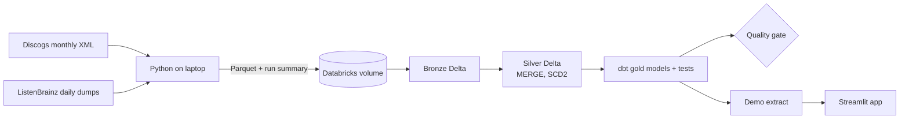

# Drop Atlas

Which melodic bass artists and labels are rising, who works with whom, and who should a
Seven Lions or Illenium fan hear next? A data pipeline over two large, messy, public music
datasets answers it.

**Live demo:** <your Streamlit link>

## What it does
- Streams the monthly Discogs dump (about 10 GB of gzipped XML) into Parquet with flat memory,
  quarantining bad records instead of crashing.
- Lands ListenBrainz listen dumps daily; loads are idempotent (running a day twice changes nothing).
- Keeps artist history as SCD2 in Delta, dated by the dump it came from.
- Matches listens to Discogs artists three ways (MusicBrainz id, full name, split credit) and
  measures how often each one fires.
- Builds gold models in dbt with tests and a unit test; a quality gate stops the daily run when
  data looks wrong.

## Numbers
| | |
|---|---|
| Discogs releases per snapshot | |
| Full parse time / peak memory | |
| Listens loaded | |
| Scene artists | |
| Artists linked to MusicBrainz | |
| Match precision (hand-checked sample) | |

## Architecture

## Run it
See `docs/` for decisions and the runbook.
